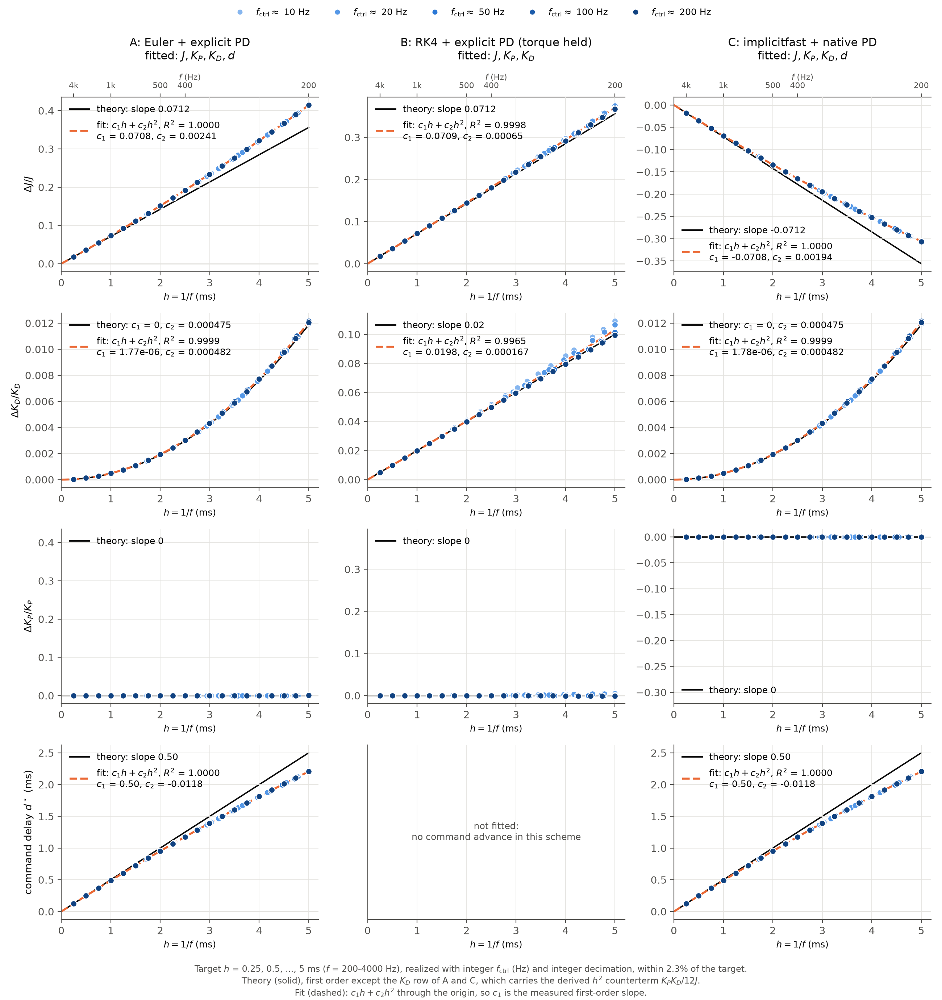
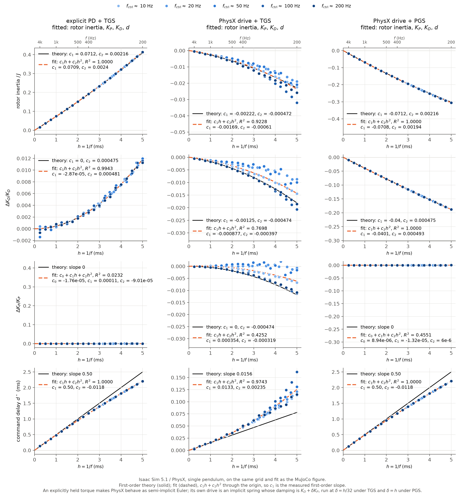
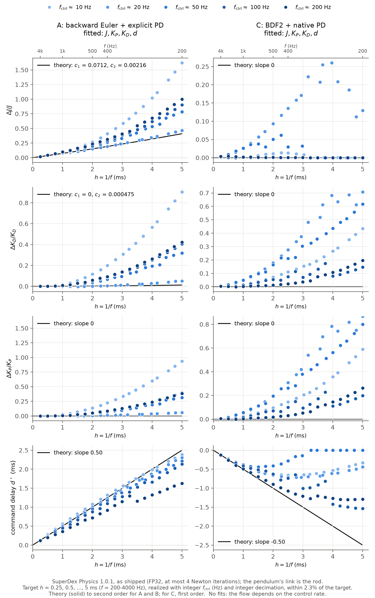

# 用 R4R 检验物理引擎的工程质量

[R4R](https://github.com/WhymustIhaveaname/R4R) 也能检验物理引擎的工程质量。思路很简单：我们不比较 sim 和 real，而是比较同一个引擎在不同频率下的行为。

步长 $h$ 带来的误差，在好的引擎里可以被几个等效参数吸收：惯量 $J$、增益 $K_P$ 和 $K_D$、命令延迟 $d$。这些参数只随 $h$ 变，变化规律可以从引擎源码推导出来。所以在不同控制频率 $f_\mathrm{ctrl}$ 下拟合出的点，应当落在同一条曲线上，而且这条曲线应当与理论一致。我们把这个性质叫作 consistency。判据一眼可见：

- 点落在同一条线上：好。
- 点按控制频率散开：差。引擎误差里有参数吸收不了的项，在一个控制频率下辨识出的参数，换一个频率就不对了。
- 点沿 $h$ 乱跳：最差。

<table align="center">
  <tr>
    <td></td>
    <td></td>
    <td></td>
  </tr>
  <tr>
    <td align="center">MuJoCo</td>
    <td align="center">Isaac Sim</td>
    <td align="center">SuperDex</td>
  </tr>
</table>

点的颜色是控制频率。排名如下：

**MuJoCo = MuJoCo Warp = Genesis > Isaac Sim（PhysX）> SuperDex（Mochi）**

- **MuJoCo**：三种 scheme 的点都落在同一条线上，并且贴合理论。MuJoCo Warp 与 MuJoCo 的差别在 float32 round-off 以内。
- **Genesis**：Euler 和 implicitfast 与 MuJoCo 的差别同样在 float32 round-off 以内。默认的 approximate_implicitfast 只在有约束时与 implicitfast 不同，这个单摆没有约束，所以没有单独扫。
- **Isaac Sim**：PGS drive 与 MuJoCo 一样好。explicit PD 贴合理论，但点比 MuJoCo 散。PhysX 自己的 drive 在 TGS 下按控制频率散开，而 TGS 是默认的 solver。
- **SuperDex**：backward Euler + explicit PD 和 BDF2 + native PD 都按控制频率散开，BDF2 + native PD 还沿 $h$ 乱跳。backward Euler + native PD 跑不起来。

## SuperDex 的已知问题

| # | 问题 | 后果 | 性质 |
|---|---|---|---|
| 1 | **力的时刻**：Mochi 在步末求重力 | 多出一项 $h\,c\cos\theta\,\dot\theta$，即随姿态变化的阻尼，没有参数能吸收 | 全隐式积分的设计 |
| 2 | **最大坐标**：Mochi 在最大坐标下处理 link 的惯量 | 多出一项 $h\,J_\mathrm{link}\,\dot\theta^3$。把 link 的惯量减到 1%，backward Euler 配两种 PD 的点就几乎落在同一条线上 | 设计 |
| 3 | **armature 不能为负**：关节惯量等于 link 惯量加 armature。MuJoCo 和 PhysX 只要求总惯量为正 | 等效惯量不能低于 link 本身。backward Euler + native PD 跑不起来，BDF2 + native PD 约三分之一的点卡在这道下限上 | 设计 |
| 4 | **阻尼项对命令求差分**：native PD（pose controller）阻尼的是 $\dot q - (r - r_\mathrm{old})/h$ | held command 每跳一次，阻尼项就产生一次 kick。我们每一步都重置目标来绕开它 | 默认行为上的坑 |
| 5 | **BDF2 的寄生模态**：BDF2 是两步法 | held command 一跳，就激发寄生模态，所以 BDF2 + native PD 按控制频率散开。把 link 惯量减到 1% 也没有用 | 设计 |
| 6 | **constraint 关节是软的**：constraint 关节是弹簧加阻尼 | 多出自由度。刚性关节要用 articulated actor | 写给用户的提醒 |
