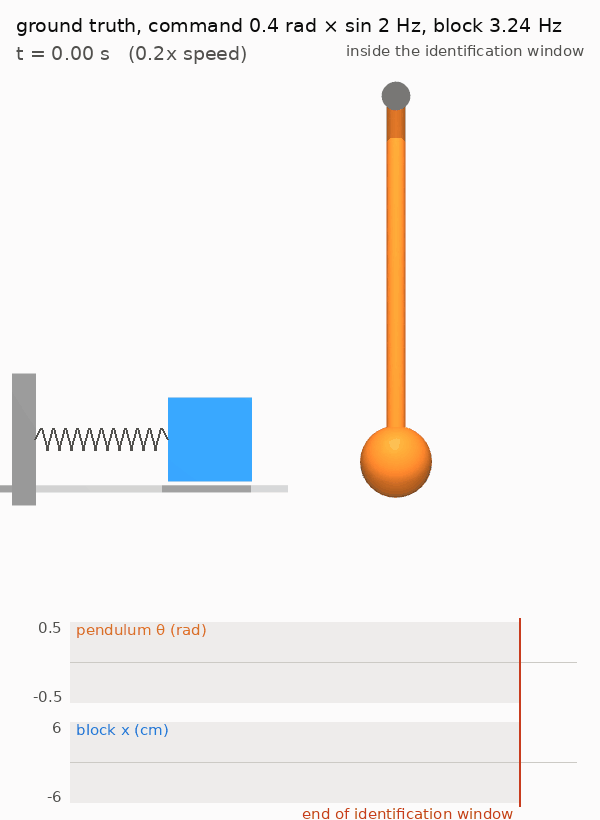
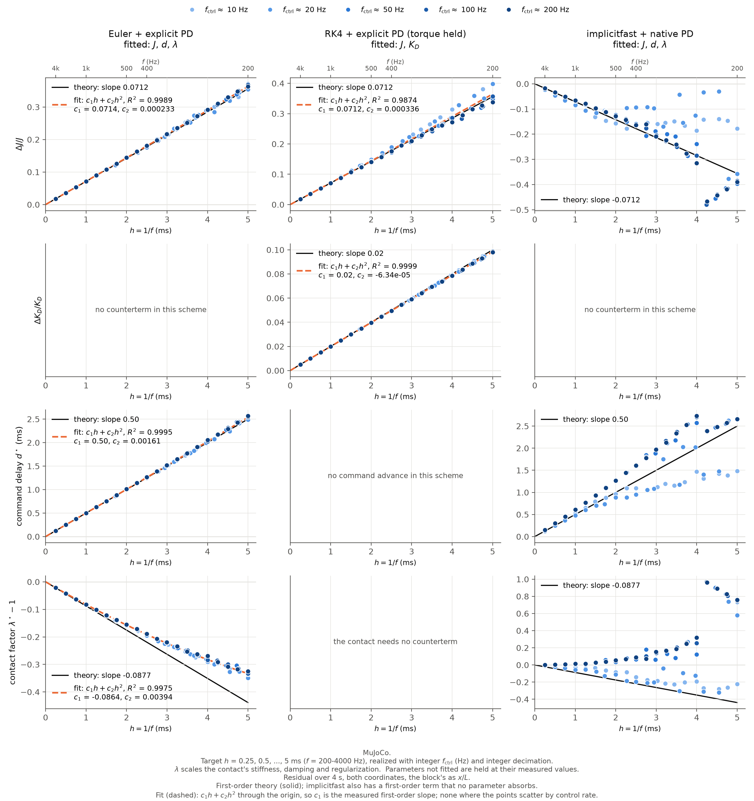
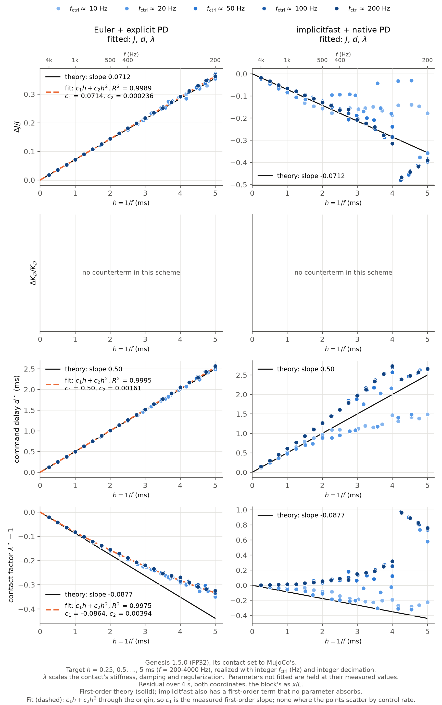

# Experiment 3: a pendulum striking a slider

<p align="center">
  
</p>

The pendulum of experiment 1 follows a 2 Hz sine command of 0.4 rad. A ball on its tip strikes a cube. The cube slides on a frictionless rail and hangs on an undamped spring. Its natural frequency is 3.24 Hz, the golden ratio times 2 Hz. The strikes damp the cube, so after about 1.5 s the motion locks onto the period of the command. The contact is MuJoCo's soft contact with an elliptic friction cone. Its friction is 0.01, the smallest that Genesis allows. The fit uses the pendulum angle and the cube position over 4 s.

## Counterterms

The contact adds one effective parameter: a factor $\lambda$ on its stiffness, its damping and its regularization. In MuJoCo's parameters, this is `timeconst / λ`, `dampratio · √λ` and `invweight · λ`.

| Scheme | $J^\star - J$ | $K_D^\star - K_D$ | $d^\star$ | $\lambda^\star$ |
|---|---|---|---|---|
| Euler + explicit PD | $h K_D / 2$ | 0 | $h/2$ | $1 - h b / 2$ |
| RK4 + explicit PD | $h K_D / 2$ | $h K_P / 2$ | 0 | 1 |
| implicitfast + native PD | $-h K_D / 2$ | 0 | $h/2$ | $1 - h b / 2$, and a remainder |

$b = 2 / (d_\mathrm{max}\, t_c)$ = 175 /s is the damping rate of the contact. In Euler, the contact damps a velocity that lags by half a step. RK4 computes the contact again at each stage, so the contact needs no counterterm. In implicitfast, the contact damping lags as in Euler. But implicitfast solves the contact with $M$, not with $M + h K_D$. The contact thus also sees the rod's acceleration $(1 + h K_D / J)$ times too large, and no parameter absorbs this remainder. `probe_counterterms.py` derives each row and checks it: after renormalization, the error falls as $h^2$ in Euler and RK4, but only as $h$ in implicitfast.

## Flow of the effective parameters

<table align="center">
  <tr>
    <td></td>
    <td></td>
  </tr>
  <tr>
    <td align="center">MuJoCo</td>
    <td align="center">Genesis</td>
  </tr>
</table>

In MuJoCo, at 0.25 ms, the fit removes 99.8% of the error in Euler and RK4, but only 66% in implicitfast.

Genesis gives MuJoCo's results in both schemes. In Euler, the fitted parameters agree within 0.06%. In implicitfast, they agree within 1%, except at one point where the two fits find different minima with the same error. Like MuJoCo's, Genesis's implicitfast solves the contact with $M$.

Genesis 1.5.0 reads the same model file, but by default it resolves the contact differently:

| # | Genesis default | MuJoCo | Here |
|---|---|---|---|
| 1 | friction at least 0.01; `condim` is ignored | frictionless contact is possible | friction 0.01 in both engines |
| 2 | contact solver `signorini` for the elliptic cone | `convex` | `contact_resolution=convex` |
| 3 | `impratio` 100 for the elliptic cone | 1 | `impratio=1` |
| 4 | inverse weight $1/(3m)$ for a sliding body, which makes the regularization 2.6× smaller | $1/m$ | MuJoCo's values, written into Genesis's arrays |
| 5 | inverse weights recomputed when the armature changes; no setter | fixed at compile time | written after each armature change |
| 6 | contact parameters per geom, not per environment | per model | one model copy per environment |
| 7 | rotor inertia 0.1 kg m² on each joint without one | 0 | `default_armature=None` |

## Reproduce

```bash
uv sync --extra genesis
cd exp3_slider
uv run python sanity_check.py
uv run python probe_counterterms.py
./launch.sh                     # about 30 min on 25 cores
uv run python plot_flow.py
uv run python video.py          # needs EGL
```
