# 实验 4: 豆腐

机器人拿起, 按压, 夹持一块软固体, 比如豆腐或果冻. 仿真要做到两件事:

1. 弹性响应对: 晃动和回弹.
2. 压坏的那一刻给出信号. 信号之后的断裂不模拟.

软体有两个离散化: 时间步长 $h$ 和网格尺寸 $\Delta x$. 每个有效参数都随 $h$ 和 $\Delta x$ 两者变化. 比较两个引擎: MuJoCo 4.0.0 和 Genesis 1.5.0.

两个数值实验, 各对应一份真实数据. 数值实验只和连续体的解比.

| 数值实验 | 对应的真实数据 |
|---|---|
| **自由振动**: 6×5×4 cm 的块, 无重力, 无接触, 以连续体最低弹性模态 (14.4 Hz) 的速度场起振. | **Jello 视频**: Visual Vibration Tomography (Feng et al., CVPR 2022) 用 4000 fps 拍了一个 Jello 方块的晃动. |
| **压球**: 半径 12.7 mm 的刚性球以 2 mm/s 压进 10×10×4 cm 的板, 板底固定, 深 0.25 到 2.5 mm; Genesis 的 5 mm 网格压到 7 mm. | **Brookfield**: 仪器厂商 Brookfield 用同样的球, 同样的速度, 把五种市售豆腐压到 7 mm, 给出了峰值力. |

## 1. 模拟方法

| 方法 | 本构 | 时间积分 | 阻尼 | 与刚体的接触 | 自由振动 / Jello 视频 | 压球 / Brookfield |
|---|---|---|---|---|---|---|
| MuJoCo flex, `discrete` | Saint Venant-Kirchhoff, 线性四面体 | backward Euler (线性化) | $\beta K$ | soft contact (`solref`, `solimp`), 整个表面 | ✓ | ✗ |
| MuJoCo flex, Euler | 同上 | symplectic Euler | $\beta K$, 显式 | 同上 | ✓ | ✗ |
| MuJoCo flex, `dof="trilinear"` | 同上, 整个物体 8 个节点 | backward Euler (线性化) | $\beta K$ | 同上 | ✓ | ✗ |
| MuJoCo flex, `dof="quadratic"` | 同上, 整个物体 27 个节点 | backward Euler (线性化) | $\beta K$ | 同上 | ✓ | ✗ |
| Genesis FEM, explicit | stable neo-Hookean, 线性四面体 | symplectic Euler | 每步速度乘 $e^{-ch}$ (质量比例) | legacy coupler, 只在顶点 | ✓ | ✓ |
| Genesis FEM, implicit | linear corotated, 线性四面体 | backward Euler | $\beta K$ | SAP coupler, 压力场 | ✓ | ✓ |
| Genesis FEM, IPC coupler (libuipc) | stable neo-Hookean (libuipc 的, 不管 Genesis 里设什么), 线性四面体 | backward Euler (Newton) | 没有参数, 只有 backward Euler 自带的 | IPC 的 log barrier | ✓ | ✓ |
| Genesis MPM | fixed corotated (`MPM.Elastic`), MLS-MPM | symplectic Euler | 没有参数 | legacy coupler, 作用在网格节点上 | ✓ | ✓ |
| Genesis PBD | 沿四面体边的弹簧网络 | 每步 4 次 Jacobi 投影 | 没有参数 | legacy coupler, 把粒子推出球外 | ✓ | ✓ |

没试的: Genesis 的 SPH 和 SF, 用于液体和烟, 不合适.

**精度和速度 (Jello 方块).** 网格和步长都改: 网格每边 3 到 20 格 (trilinear 1 到 8 格, quadratic 1 到 4 格), 每个网格 3 到 4 个步长. 每个方法一根线, 从粗网格连到细网格, 每个网格用试过的最大步长; 更小的步长画成淡点. MPM 和 PBD 还各试了一个步长, 让它们自己的 sway 阻尼等于视频的, 也画成淡点. 横轴是集群上的 wall time 除以仿真时间, 越往右越慢; 慢 100 倍以上的不做. 左图是频率残差: 只调 $E^\star$, 拟合同一模型的连续体的 sway (8.010 Hz, 即视频的) 和 twist (10.087 Hz), 剩下的 RMS 相对误差, 只反映离散化. 不直接和视频的 twist (9.992 Hz) 比, 因为模型本身 (均匀方块, 没有视频里的黏土) 就差 0.47%, 离散化误差碰巧抵消它时残差会低得没有意义; 这 0.47% 画成点线. 右图是阻尼残差: 用引擎自带的全部阻尼参数拟合视频的两个阻尼比 (0.0151, 0.0154), 剩下的 RMS 相对误差, 反映阻尼模型.

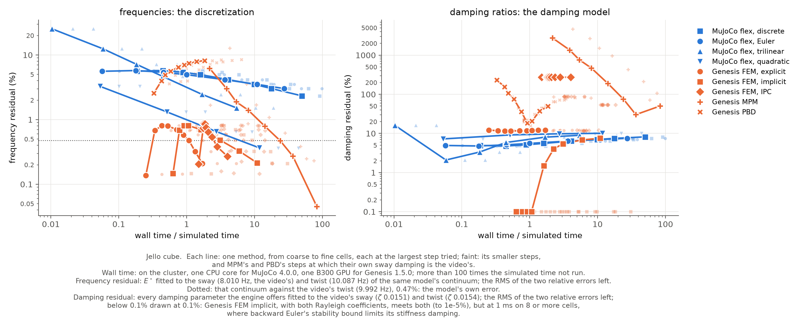

最好的是 Genesis FEM explicit. 三种 Genesis FEM 用同一个网格, 频率残差几乎一样: 20 格时 explicit 0.21%, wall time 是仿真时间的 1.7 倍; implicit 0.22%, 11 倍; IPC 0.27%, 4.0 倍. 3 格时三者只差 0.14% 到 0.21%, 这是碰巧: 只拟合两个频率, 残差只看两者之比, 3 格网格碰巧把这个比值算对了, 4 到 6 格反而差 0.7% 到 0.9%.

**结论.**

- 自由振动准: 重整化以后什么都不拟合, sway 的频率和阻尼就对上视频. 压球的误差几乎全来自网格, 压得越深, 网格越细, 误差越小. 压 0.25 mm 时接触区半径只有 1.8 mm, 比网格还小, 2 mm 网格的 implicit 仍高 60%. 在 7 mm 处定 $E^\star$, Brookfield 的五种豆腐都能对上.
- 重整化能补的: 整体变硬或变软 ($E^\star$), 步长带来的阻尼变化 ($\beta^\star$, $\zeta^\star$). 补不了的:
  - 各模态偏得不一样, 比如 trilinear 和 quadratic 的 twist;
  - 只有一个阻尼参数时, 第二个模态的阻尼; MPM, PBD 和 IPC 没有阻尼参数, 只能靠选 $h$;
  - 压球时网格偏硬的程度随压深变, 一个 $E^\star$ 只对得上一个压深;
  - MuJoCo 的接触随网格变细按 $\Delta x^3$ 变软;
  - PBD 的力不和 1/compliance 成正比.
- 推荐 Genesis FEM. 要快用 explicit; 要两个阻尼比都对用 implicit; IPC 的 Brookfield 最准, 但阻尼只能靠选 $h$. MuJoCo 压球没有可用的结果; MPM 和 PBD 的阻尼不能调.

## 2. 重整化

要重整化的参数: 杨氏模量 $E^\star$, 阻尼 ($\zeta^\star$ 或 $\beta^\star$), MuJoCo 接触的时间常数 (`solref`).

### 2.1 MuJoCo flex, `discrete`

**自由振动.** $E^\star = E\,S(\Delta x)\,T(h)$. $S$ 由仿真网格的最低模态算出; 顶点质量相等, 所以 $S - 1$ 随 $\Delta x$ 线性变化. $T(h) = 1 + h\beta\omega^2/2 + h^2\omega^2(2\beta^2\omega^2 - 1)/12$, $\beta^\star = \beta - h + h^2\beta\omega^2/12$, 其中 $\omega = 2\pi \times 14.4$ Hz 是这个模态的角频率. 阻尼只随 $h$ 改. $h$ 大于 $2\beta$ = 4.4 ms 时, 没有任何 $E^\star$ 和 $\beta^\star$ 能给出这个模态.

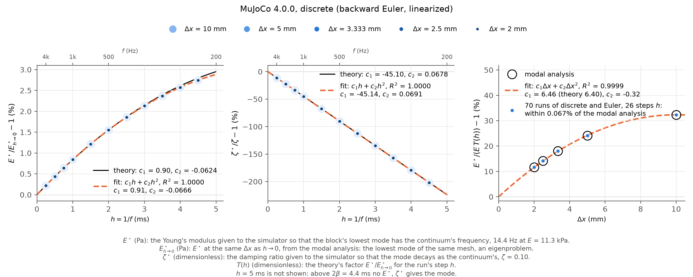

**Jello 视频.** 仿真参数用上面公式算出的 $E^\star$ 和 $\beta^\star$, $S$ 由 Jello 方块自己的网格算出, 什么都不拟合. 视频: [`results/jello.mp4`](results/jello.mp4).

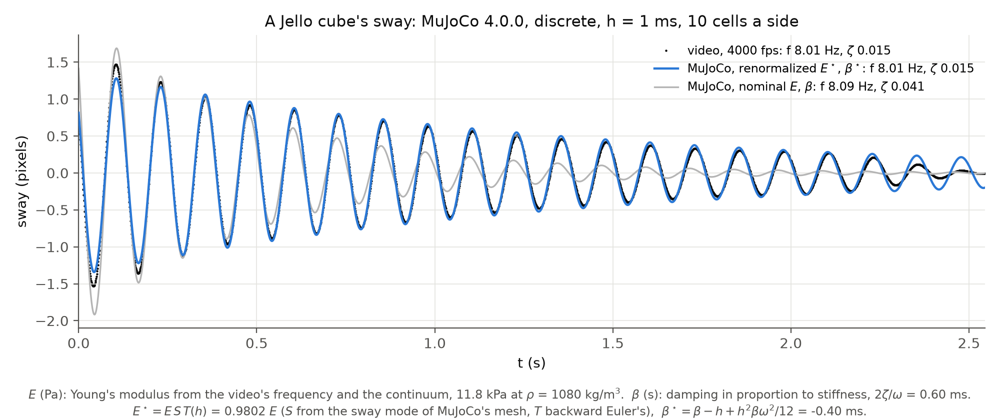

**压球.** 没有可用的结果, 原因有三个:

- 材料: Saint Venant-Kirchhoff 压到 2.9 mm 以后, 力不随网格收敛, 所以压不到 Brookfield 的 7 mm.
- 网格: 压 2.5 mm 以内, 球下的接触区半径只有 1.8 到 5.6 mm, 比 2 到 10 mm 的单元还小, 力差 10% 到 440%. 要准, 网格得细到 0.4 mm 左右, 而 MuJoCo 在 2 mm 网格上已经要 1 s 一步.
- 接触: 每个接触是一根弹簧, 它的刚度随网格变细按 $\Delta x^3$ 变软. 要它不变软, `solref` 的时间常数得随网格缩小, 步长也得跟着缩小, 2 mm 网格要 0.18 ms 以下.

### 2.2 MuJoCo flex, Euler

**自由振动.** $E^\star = E\,S(\Delta x)\,T(h)$, $T(h) = 1 - h\beta\omega^2/2 + h^2\omega^2(2\beta^2\omega^2 - 1)/12$, $\beta^\star = \beta + h^2\beta\omega^2/12$. $S$ 与 MuJoCo discrete 相同 (网格和顶点质量相同), 它的 run 画在 2.1 图最右的面板里.

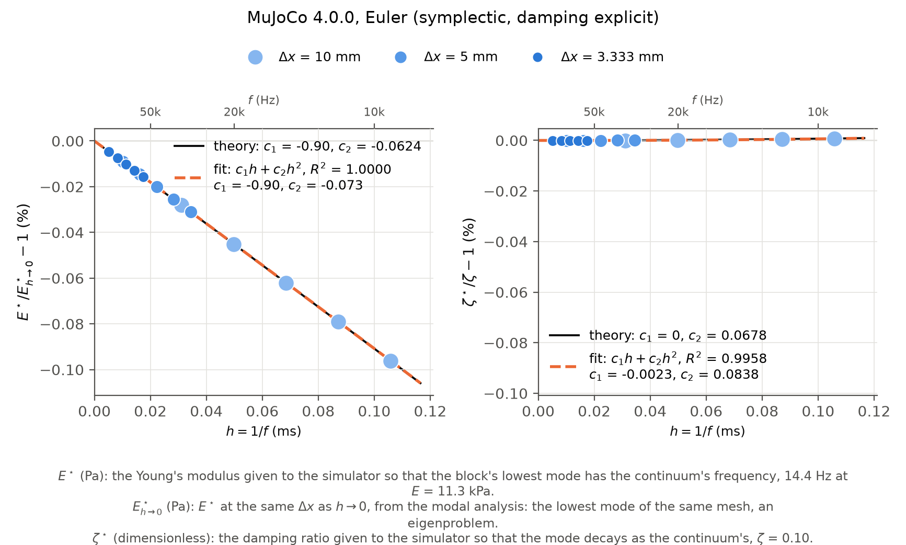

**Jello 视频.** 公式同上, $h$ = 0.1 ms, 稳定上限是 0.15 ms. 这么小的步长下 $T(h)$ 和 $\beta^\star$ 与 1 和 $\beta$ 只差 $10^{-4}$, 起作用的是 $S$.

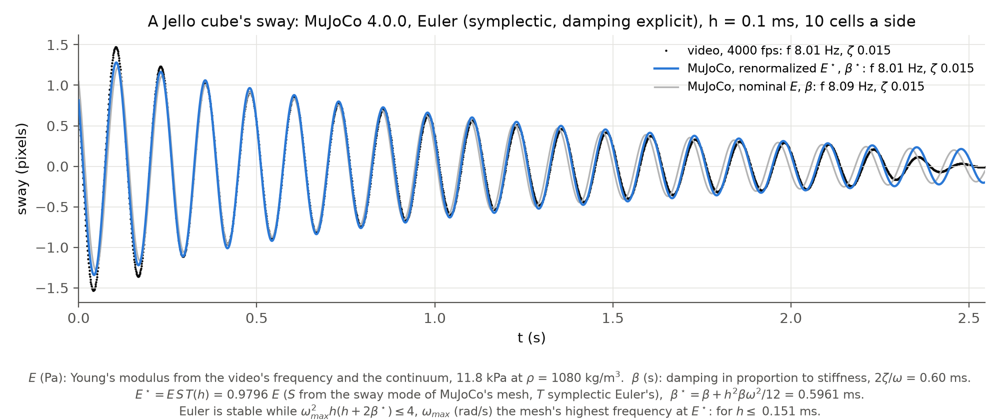

**压球.** 5 mm 网格, $h$ = 0.045 ms, 每个压深的力都和 MuJoCo discrete 同网格, 同接触的结果相差 0.1% 以内. 用默认接触 (`solref` 时间常数 0.02 s), 力比连续体低 49% 到 70%; 用硬接触 (时间常数 0.002 s, `solimp` 0.99), 高 65% 到 176%. 所以问题同 MuJoCo discrete, 也压不到 Brookfield 的 7 mm. 更细的网格做不了: 显式的 $\beta K$ 阻尼让步长上限随 $\Delta x^2$ 缩小, 3.3 mm 网格竟然要求 0.02 ms 以下, 太慢而不可行.

### 2.3 MuJoCo flex, `dof="trilinear"`

**自由振动.** 整块只有一个单元. $E^\star = E\,S\,T(h)$, $T(h)$ 和 $\beta^\star$ 与 MuJoCo discrete (或 Euler) 相同. $S$ 由 MuJoCo 自己的质量矩阵和弹性力的切线解出的模态算出: $S$ = 6.23. 这个模态的形状能表示, 与连续体的重合度是 0.989. $S$ 这么大, 是因为 MuJoCo 把质量都放在 8 个角点上, 动能多算了 9 倍.

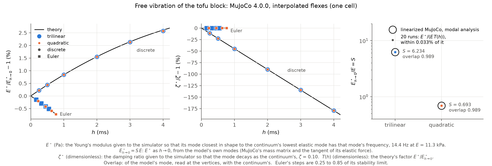

**Jello 视频.** $E^\star$ = 2.22 $E$, sway 的频率和阻尼都对上. 但这时它的 twist 在 5.9 Hz, 视频里是 10.0 到 10.4 Hz: 一个 $E^\star$ 对不上两个模态.

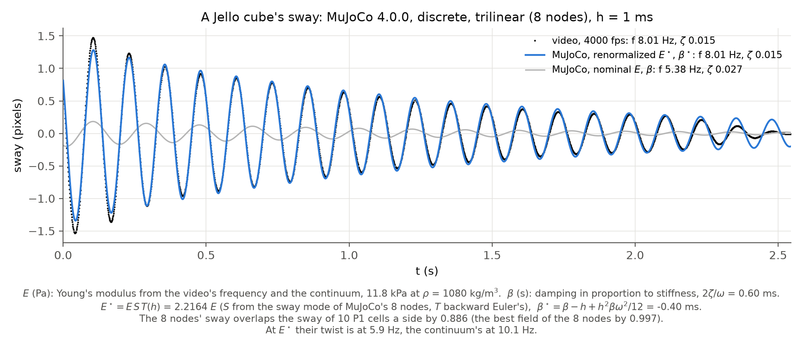

**压球.** 不做: 整块只有 8 个节点, 分辨不了球下的压痕.

### 2.4 MuJoCo flex, `dof="quadratic"`

**自由振动.** 同 trilinear, $S$ = 0.693, 画在 2.3 的图里. 它最低的弹性模态对应连续体的第二个模态, 要找的是它的第二个模态.

**Jello 视频.** $E^\star$ = 0.929 $E$, sway 对上. twist 在 9.45 Hz, 视频是 10.0 到 10.4 Hz. $h$ = 5 ms 时不稳定: $\beta^\star < -h/2$ 时, backward Euler 会放大 $\omega^2 h(-2\beta^\star - h) > 4$ 的模态.

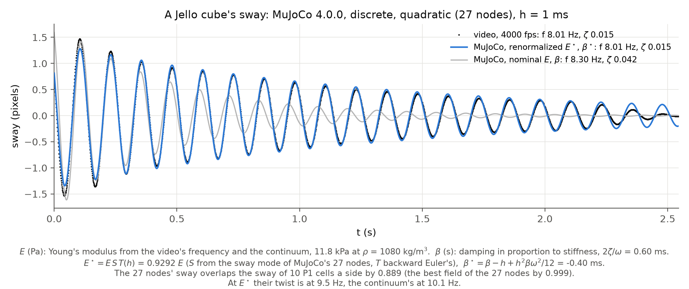

**压球.** 不做: 整块只有 27 个节点, 分辨不了球下的压痕.

### 2.5 Genesis FEM, explicit

**自由振动.** $E^\star = E\,S(\Delta x)\,T(h)$. 质量按体积分配, 所以 $S - 1$ 随 $\Delta x^2$ 变化. $T(h) = 1 + hc/2 + h^2(2c^2 - \omega^2)/12$, 其中 $c = 2\zeta\omega$. $\zeta^\star = \zeta$: 阻尼参数不用随 $h$ 和 $\Delta x$ 改.

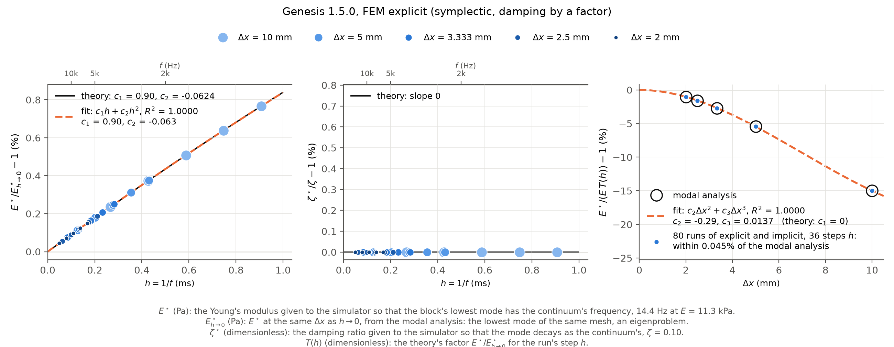

**Jello 视频.** 公式同上, $h$ 取稳定上限的一半 (0.24 ms), 阻尼参数 $c = 2\zeta\omega$ 不改. 什么都不拟合.

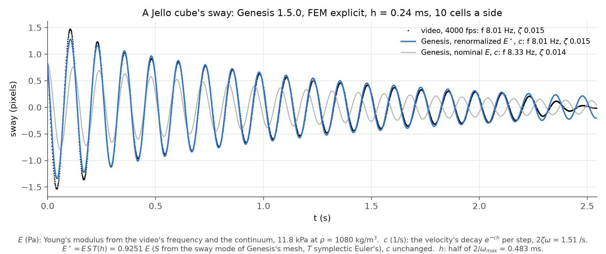

**压球.** 接触参数不用随网格改. 5 mm 网格一直压到 Brookfield 的 7 mm.

**Brookfield.** 每种豆腐的 $E$ 由它的实测力反推 (第 3 节), 再乘上 $F_{\mathrm{ref}}/F_{\mathrm{mesh}}$ 得到 $E^\star$, 其中 $F_{\mathrm{mesh}}$ 是 5 mm 网格在 7 mm 处的静力解. 给 Genesis $E^\star$, 五种豆腐的力都和实测相差 2% 以内; 给原始的 $E$, 高 14%.

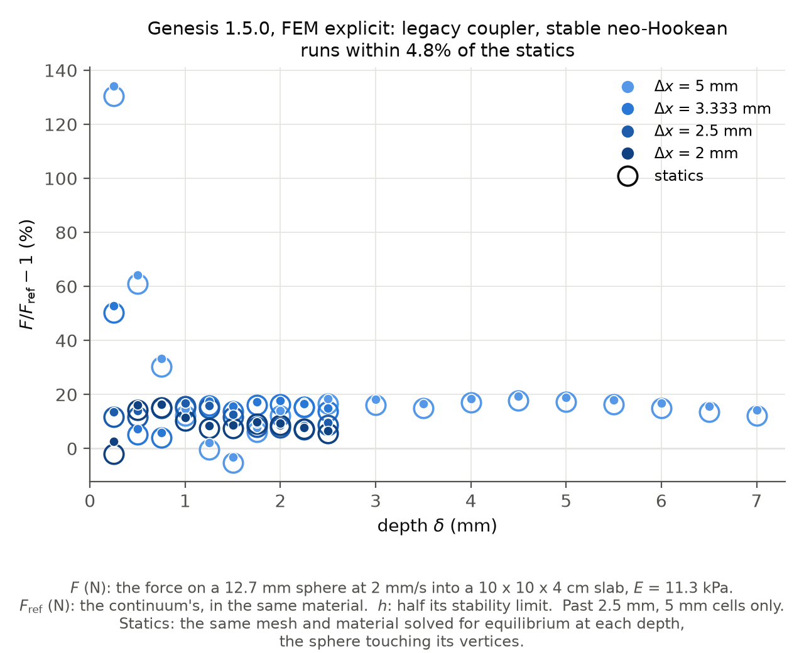

### 2.6 Genesis FEM, implicit

**自由振动.** $E^\star$ 和 $\beta^\star$ 的公式与 MuJoCo discrete 相同, 只是 $S$ 按体积分配的质量算 (与 Genesis FEM explicit 相同), 它的 run 画在 2.5 图最右的面板里.

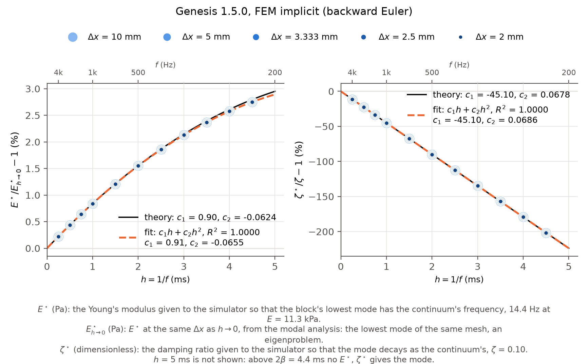

**Jello 视频.** 公式同上, $h$ = 1 ms. 什么都不拟合.

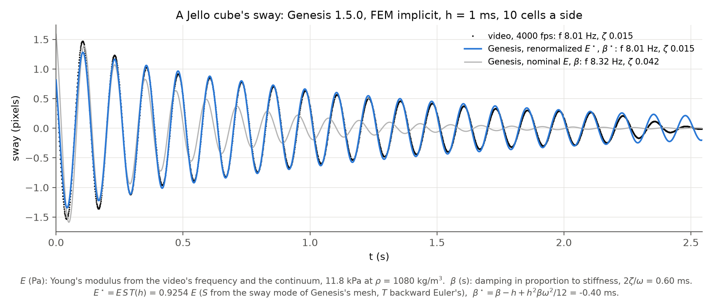

**压球.** SAP 的接触是一层压力场, 每压入 1 m 产生 5e8 Pa 的压力. 这层的刚度与 $\Delta x$ 无关, 所以接触参数不用随网格改. 5 mm 网格一直压到 Brookfield 的 7 mm.

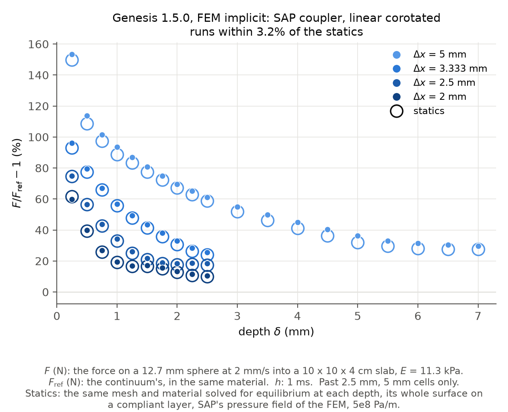

**Brookfield.** 做法同 Genesis FEM explicit, 只是每种豆腐的 $E$ 按 linear corotated 反推. 给 Genesis $E^\star$, 五种豆腐的力都和实测相差 1.7%; 给原始的 $E$, 高 30%.

### 2.7 Genesis FEM, IPC coupler

**自由振动.** $E^\star = E\,S(\Delta x)\,T(h)$, $S$ 同 Genesis FEM (质量按体积分配). IPC 没有阻尼参数, 唯一的阻尼是 backward Euler 自带的: 每步把模态乘上 $1/(1 - i\omega h)$, 阻尼比约为 $\omega h/2$, 只由 $h$ 决定. 豆腐的 0.10 要 $h$ = 2.225 ms. Newton 的收敛容差要收紧, 用 Genesis 的默认值, 频率低 $3\times10^{-4}$.

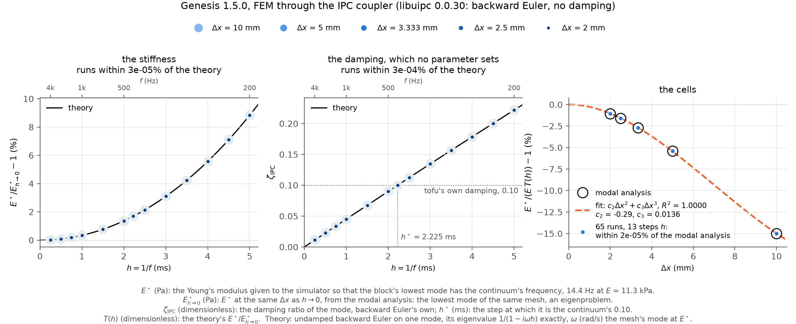

**Jello 视频.** 视频的阻尼比 0.015 要 $h$ = 0.596 ms; $E^\star$ 由上面的公式算出, 什么都不拟合.

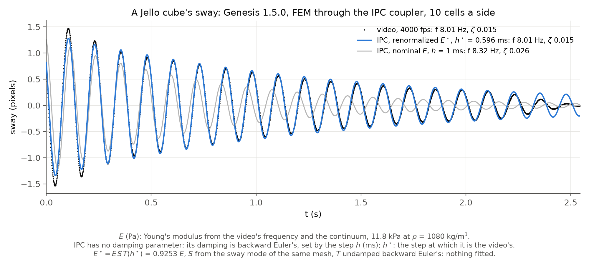

**压球.** 接触距离 `d_hat` 取 2 μm, Newton 容差收紧 (见第 4 节). 5 mm 网格一直压到 Brookfield 的 7 mm, 1.5 到 7 mm 都和静力解相差 1% 以内. 浅处的偏差主要来自静力解本身: 接触点取得更密, 0.25 到 0.75 mm 的静力解会变 −5% 到 +7%. 3.333 mm 网格最多差 4.5%, 2.5 mm 网格每个压深都在 1% 以内. 2 mm 网格压深以后只有实时的 0.005 倍, 按截断不做. `d_hat` 从 2 μm 减到 1 μm, 力只变 0.4% 以内.

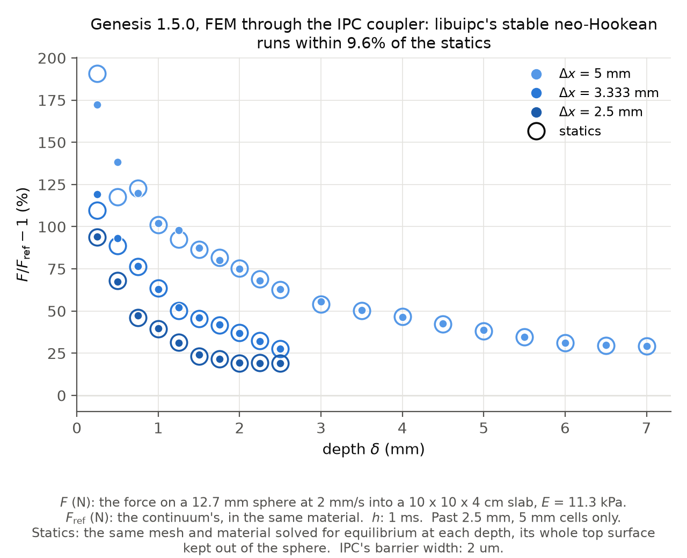

**Brookfield.** 做法同 Genesis FEM explicit. 给 Genesis $E^\star$, 五种豆腐的力都和实测相差 0.1%; 给原始的 $E$, 高 29%.

### 2.8 Genesis MPM

**自由振动.** 空心圈是把 MLS-MPM 的一步在静止处线性化, 再用读 run 的同一种方法读出的频率和阻尼. 阻尼没有参数可调, $\zeta_{\mathrm{MPM}} \approx 8.5\times10^{3}\,\Delta x^4/h$ (s, m).

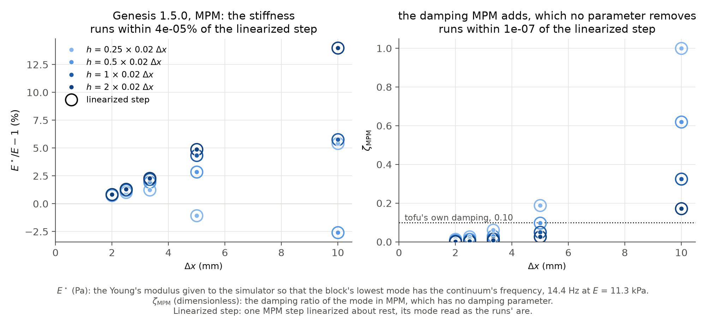

**Jello 视频.** 5 mm 网格, 底部用一层固定的粒子夹住. 阻尼只由 $\Delta x$ 和 $h$ 定, $h$ 取线性化一步的阻尼比正好是视频的 0.015 的那个: 0.116 ms. $E^\star$ = 1.05 $E$, 也由线性化一步算出. 什么都不拟合, sway 对上了.

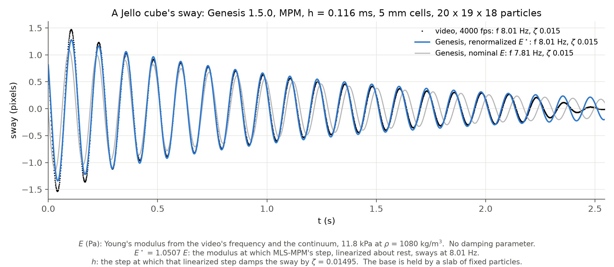

**压球.** 连续体的解也按 fixed corotated 算. 接触作用在网格节点上, 所以最多提前一个格子开始. $h$ 取 Genesis 建议的 0.02 $\Delta x$ (s, m). 只有 5 mm 网格快于实时的 0.01 倍 (0.016 倍), 更细的网格按截断不做. 用 $E$ 时力比连续体低 18% 到 69%, 7 mm 处低 52%. MPM 没有静力解, 只和连续体比.

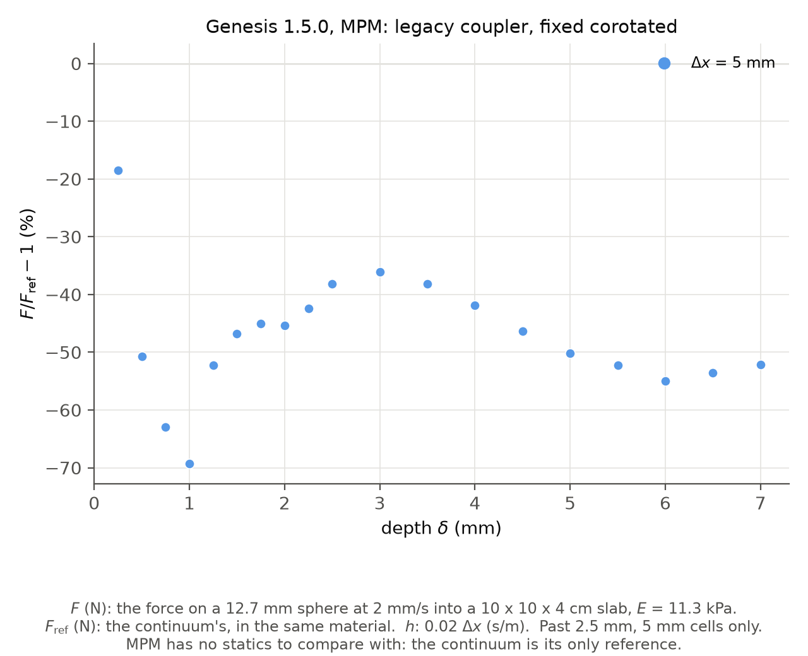

**Brookfield.** 做法同 Genesis FEM explicit, 只是每种豆腐的 $E$ 按 fixed corotated 反推, $F_{\mathrm{mesh}}$ 取 5 mm 网格的 run. 给 Genesis $E^\star$ (2.09 $E$), 五种豆腐的力比实测低 1.8% 到 3.0%; 给原始的 $E$, 低 52% 到 53%.

### 2.9 Genesis PBD

**自由振动.** 空心圈是把 PBD 的一步在静止处线性化后读出的频率和阻尼: $u' = P^4(2u - u_{\mathrm{prev}})$, $P = I - cL$, $c = r/(2 + m\alpha/h^2)$. 其中 $u$ 是位移, $L$ 是单位弹簧网络的刚度矩阵, $r$ = 0.1 是 Genesis 的松弛系数, $m$ 是粒子质量, $\alpha$ 是 compliance. 只有 $h < h_{\max}$ 时才有 $E^\star$; PBD 自带的阻尼比 $\zeta \approx \omega h/2$, 没有参数.

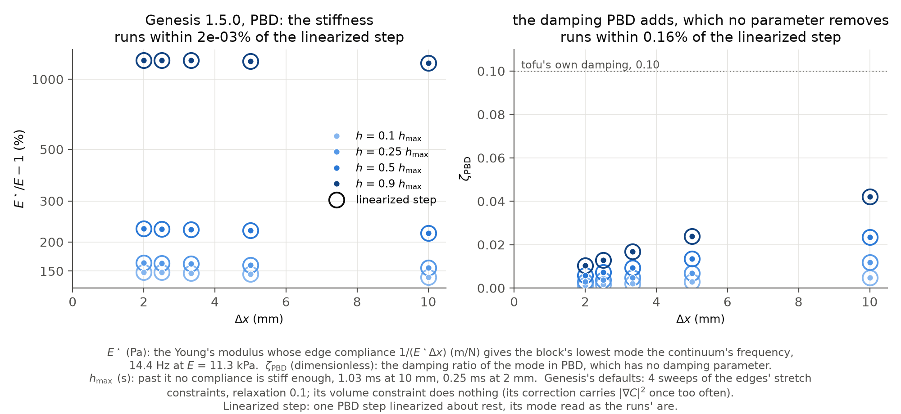

**Jello 视频.** PBD 自带的阻尼随 $h$ 变, $h$ 取线性化一步的阻尼比正好是视频的 0.015 的那个: 0.596 ms. 它离上限 0.618 ms 很近, 再大任何 compliance 都到不了 8.01 Hz. compliance 也由线性化一步算出, 相当于 $E^\star$ = 32.5 $E$. 什么都不拟合, sway 对上了. 豆腐的 0.10 超过 PBD 能给的最大阻尼比 0.043, 所以对豆腐不行.

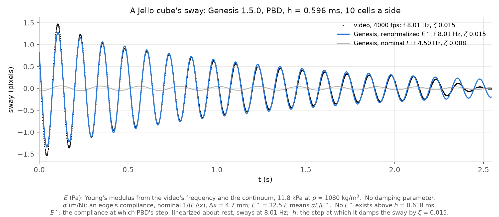

**压球.** 粒子被推到离球面 particle_size/2 处, 所以球的 geom 半径取 $R$ − particle_size/2, 粒子停在半径 $R$ 的球面上. $h = 0.5\,h_{\max}$, 每条边的 compliance 取 $1/(E\Delta x)$. 力比连续体低 28% 到 83%; 网格变细, 也停在低 63% 左右, 不收敛到 0.

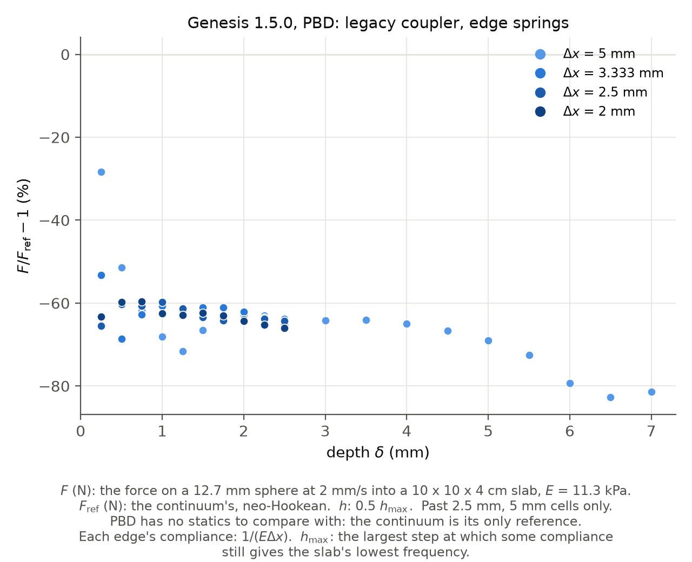

**Brookfield.** PBD 的力不和 1/compliance 成正比, 所以每种豆腐的 compliance 单独拟合, 让 5 mm 网格在 7 mm 处的力对上实测. compliance 为 0 时力最大, 且随 $1/h^2$ 变: $h = 0.5\,h_{\max}$ 时只有 2.55 N, 三种硬豆腐对不上; $h = 0.25\,h_{\max}$ (161 μs, 实时的 0.076 倍) 时是 10.2 N, 五种豆腐都对上, 相差 0.3% 以内. 这时 $E^\star$ 是每种豆腐的 $E$ 的 5.8 到 8.9 倍, 不是同一个倍数. 给原始的 $E$, 低 82% 到 85%.

## 3. 豆腐和果冻的真实参数

| 材料 | 量 | 值 | 来源 |
|---|---|---|---|
| 豆腐, Mori-nu silken soft / firm / extra firm | 剪切模量 $\mu$, 14 Hz | 3.88 / 11.8 / 21.1 kPa | Pattison et al. 2015 |
| | 阻尼比 $\zeta$ | 0.10 / 0.11 / 0.12 | 同上 |
| | 泊松比 $\nu$ | 0.45 (假设) | 同上 |
| 豆腐, firm / extra firm | $G'$, 0.22 到 4.64 rad/s | 5.67 / 11.0 kPa | Dunne et al. 2025 |
| | $\tan\delta$ | 0.229 / 0.241 | 同上 |
| 豆腐, 五个牌子 | 25.4 mm 球压到 7 mm 的峰值力 | 173 到 479 g | Brookfield 应用说明 |
| | 由此反推的 $E$ (neo-Hookean) | 13.3 到 36.7 kPa | 本实验, 由上一行的力反推 |
| 绢豆腐 | 压缩破坏的名义应力 | 7.1 到 8.4 kPa | Kohyama and Nishinari 1992 |
| | 压缩破坏的工程应变 | 0.44 到 0.56 (Green 应变 0.34 到 0.40) | 同上 |
| 明胶, 2 / 4 / 6 / 8% | $E$ | 3.2-4.0 / 10.6-14.6 / 22.9-34.2 / 40.4-50.2 kPa | Gravelle and Marangoni 2021 |
| | 真实破坏应力 | 7-10 / 21-30 / 33-51 / 52-63 kPa | 同上 |
| Jell-O, 流变仪 | $G'$, $G''$, 10 rad/s | 168 Pa, 6 Pa | Ata et al. 2026 |
| Jello 方块, 视频 | 两个 sway / twist 的频率 | 8.0 到 8.3 / 10.0 到 10.4 Hz | 本实验, Jello 视频 |
| | $\zeta$ | 0.015 到 0.022 | 同上 |
| | $E$ ($\rho$ = 1080 kg/m³) | 11.8 kPa | 同上 |

牌子, 频率, 应变, 温度和凝固时间, 每一项都能让这些值差到 10 倍.

## 4. 引擎的坑

- MuJoCo 4.0 的 `discrete` 积分器会限制接触刚度: $K \to \min(K, 1/(h^2 d))$ (`mj_makeImpedance` 里的 refsafe).
- MuJoCo 的 `flexvert_xpos` 在 `mj_step` 之后滞后一步. 要从 `qpos` 读顶点.
- MuJoCo 球面接触的法向沿半径方向. 球受的力要取竖直分量; 把各接触力的大小直接相加, 会高 3% 到 5%.
- Genesis 的 legacy coupler 默认 `coup_softness` 为 2 mm, 和压深一样厚. 要设成 1e-5 m.
- Genesis 每步把被驱动的球放回指定位置, 但一步之内板会把球推回去. 球取豆腐的密度时, 力会低 20%. 要用 1e7 kg/m³ 的球.
- Genesis 默认把碰撞网格简化到 500 个面 (`decimate`, 由 `convexify` 隐含). 要加 `decimate=False`.
- Genesis 的 PBD 体积约束, 修正量多乘了一次 $|\nabla C|^2$, 所以实际不起作用.
- Genesis 1.5.0 在 CPU 上每个进程只用一个线程.
- Genesis 的 IPC coupler 把 FEM 交给 libuipc 算: 材料固定是 libuipc 的 stable neo-Hookean, Genesis 的阻尼选项传不进去, 也不能固定顶点或设初速度.
- IPC 的 Newton 容差默认 `velocity_tol` = 0.05 m/s, 对豆腐太松: 压球力差 40% 到 60%. 接触距离 `d_hat` 默认 1 cm, 不能用; 1e-5 m 仍留下 8 μm 的间隙, 压 0.25 mm 时力高 4%, 要 2e-6 m.
